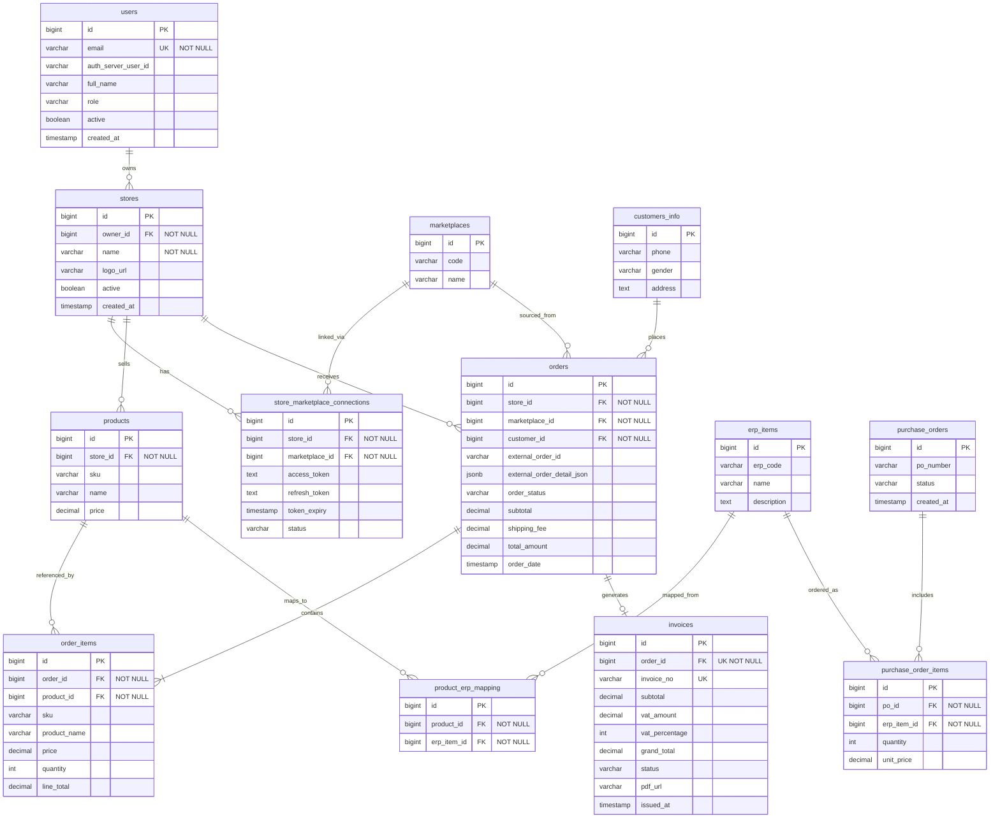

# Laco Invoice — Entity Relationship Diagram

> Source diagram: [`ERD.png`](./ERD.png)

This schema models a multi-store, multi-marketplace order and invoicing platform with ERP integration. Thirteen tables span identity & stores, marketplace connections, catalog & orders, invoicing, and ERP purchase flows.

## Overview

| Domain | Tables |
|--------|--------|
| Identity & tenancy | `users`, `stores` |
| Marketplace integration | `marketplaces`, `store_marketplace_connections` |
| Customers & catalog | `customers_info`, `products` |
| Orders & invoicing | `orders`, `order_items`, `invoices` |
| ERP integration | `erp_items`, `product_erp_mapping`, `purchase_orders`, `purchase_order_items` |

## Entity Relationship Diagram



## Tables

### `users`

Application users (store owners and staff). Linked to an external auth server.

| Column | Type | Constraints |
|--------|------|-------------|
| `id` | BIGINT | PK |
| `email` | VARCHAR(255) | UNIQUE, NOT NULL |
| `auth_server_user_id` | VARCHAR(255) | |
| `full_name` | VARCHAR(255) | |
| `role` | VARCHAR(50) | |
| `active` | BOOLEAN | |
| `created_at` | TIMESTAMP | |

---

### `marketplaces`

Reference data for supported sales channels (e.g. TikTok, Shopee, Lazada).

| Column | Type | Constraints |
|--------|------|-------------|
| `id` | BIGINT | PK |
| `code` | VARCHAR(50) | |
| `name` | VARCHAR(100) | |

---

### `stores`

A tenant store owned by a user. Products and orders are scoped to a store.

| Column | Type | Constraints |
|--------|------|-------------|
| `id` | BIGINT | PK |
| `owner_id` | BIGINT | FK → `users(id)`, NOT NULL |
| `name` | VARCHAR(255) | NOT NULL |
| `logo_url` | VARCHAR(500) | |
| `active` | BOOLEAN | |
| `created_at` | TIMESTAMP | |

**Foreign keys**

- `fk_store_owner`: `owner_id` → `users(id)`

---

### `store_marketplace_connections`

OAuth / API credentials linking a store to a marketplace.

| Column | Type | Constraints |
|--------|------|-------------|
| `id` | BIGINT | PK |
| `store_id` | BIGINT | FK → `stores(id)`, NOT NULL |
| `marketplace_id` | BIGINT | FK → `marketplaces(id)`, NOT NULL |
| `access_token` | TEXT | |
| `refresh_token` | TEXT | |
| `token_expiry` | TIMESTAMP | |
| `status` | VARCHAR(50) | |

**Foreign keys**

- `fk_conn_store`: `store_id` → `stores(id)`
- `fk_conn_marketplace`: `marketplace_id` → `marketplaces(id)`

---

### `customers_info`

Buyer contact and address data attached to orders.

| Column | Type | Constraints |
|--------|------|-------------|
| `id` | BIGINT | PK |
| `phone` | VARCHAR(100) | |
| `gender` | VARCHAR(7) | |
| `address` | TEXT | |

---

### `products`

Store-scoped product catalogue (SKU, name, price).

| Column | Type | Constraints |
|--------|------|-------------|
| `id` | BIGINT | PK |
| `store_id` | BIGINT | FK → `stores(id)`, NOT NULL |
| `sku` | VARCHAR(100) | |
| `name` | VARCHAR(255) | |
| `price` | DECIMAL(18,2) | |

**Foreign keys**

- `fk_product_store`: `store_id` → `stores(id)`

---

### `orders`

Orders synced from marketplaces. Raw marketplace payload is preserved in JSON.

| Column | Type | Constraints |
|--------|------|-------------|
| `id` | BIGINT | PK |
| `store_id` | BIGINT | FK → `stores(id)`, NOT NULL |
| `marketplace_id` | BIGINT | FK → `marketplaces(id)`, NOT NULL |
| `customer_id` | BIGINT | FK → `customers_info(id)`, NOT NULL |
| `external_order_id` | VARCHAR(100) | Marketplace-side order ID |
| `external_order_detail_json` | JSONB | Full normalized/raw sync payload |
| `order_status` | VARCHAR(50) | |
| `subtotal` | DECIMAL(18,2) | |
| `shipping_fee` | DECIMAL(18,2) | |
| `total_amount` | DECIMAL(18,2) | |
| `order_date` | TIMESTAMP | |

**Foreign keys**

- `fk_order_store`: `store_id` → `stores(id)`
- `fk_order_marketplace`: `marketplace_id` → `marketplaces(id)`
- `fk_order_customer`: `customer_id` → `customers_info(id)`

---

### `order_items`

Line items on an order. Product fields are denormalized for historical accuracy.

| Column | Type | Constraints |
|--------|------|-------------|
| `id` | BIGINT | PK |
| `order_id` | BIGINT | FK → `orders(id)`, NOT NULL |
| `product_id` | BIGINT | FK → `products(id)`, NOT NULL |
| `sku` | VARCHAR(100) | Snapshot at order time |
| `product_name` | VARCHAR(255) | Snapshot at order time |
| `price` | DECIMAL(18,2) | |
| `quantity` | INT | |
| `line_total` | DECIMAL(18,2) | |

**Foreign keys**

- `fk_order_item_order`: `order_id` → `orders(id)`
- `fk_order_item_product`: `product_id` → `products(id)`

---

### `invoices`

Tax invoice generated from an order. One invoice per order.

| Column | Type | Constraints |
|--------|------|-------------|
| `id` | BIGINT | PK |
| `order_id` | BIGINT | FK → `orders(id)`, UNIQUE, NOT NULL |
| `invoice_no` | VARCHAR(50) | UNIQUE |
| `subtotal` | DECIMAL(18,2) | |
| `vat_amount` | DECIMAL(18,2) | |
| `vat_percentage` | INTEGER | e.g. 7 for 7% VAT |
| `grand_total` | DECIMAL(18,2) | |
| `status` | VARCHAR(50) | |
| `pdf_url` | VARCHAR(500) | Stored PDF location |
| `issued_at` | TIMESTAMP | |

**Foreign keys**

- `fk_invoice_order`: `order_id` → `orders(id)`

---

### `erp_items`

ERP-side item master (independent of store products).

| Column | Type | Constraints |
|--------|------|-------------|
| `id` | BIGINT | PK |
| `erp_code` | VARCHAR(100) | |
| `name` | VARCHAR(255) | |
| `description` | TEXT | |

---

### `product_erp_mapping`

Many-to-many bridge between store products and ERP items.

| Column | Type | Constraints |
|--------|------|-------------|
| `id` | BIGINT | PK |
| `product_id` | BIGINT | FK → `products(id)`, NOT NULL |
| `erp_item_id` | BIGINT | FK → `erp_items(id)`, NOT NULL |

**Foreign keys**

- `fk_map_product`: `product_id` → `products(id)`
- `fk_map_erp`: `erp_item_id` → `erp_items(id)`

---

### `purchase_orders`

Purchase orders raised against ERP items.

| Column | Type | Constraints |
|--------|------|-------------|
| `id` | BIGINT | PK |
| `po_number` | VARCHAR(50) | |
| `status` | VARCHAR(50) | |
| `created_at` | TIMESTAMP | |

---

### `purchase_order_items`

Line items on a purchase order, referencing ERP items.

| Column | Type | Constraints |
|--------|------|-------------|
| `id` | BIGINT | PK |
| `po_id` | BIGINT | FK → `purchase_orders(id)`, NOT NULL |
| `erp_item_id` | BIGINT | FK → `erp_items(id)`, NOT NULL |
| `quantity` | INT | |
| `unit_price` | DECIMAL(18,2) | |

**Foreign keys**

- `fk_poi_po`: `po_id` → `purchase_orders(id)`
- `fk_poi_item`: `erp_item_id` → `erp_items(id)`

## Relationship Summary

```
users
 └── stores (owner_id)
      ├── store_marketplace_connections ── marketplaces
      ├── products
      │    ├── order_items
      │    └── product_erp_mapping ── erp_items
      └── orders ── marketplaces
           ├── customers_info
           ├── order_items
           └── invoices (1:1)

erp_items
 ├── product_erp_mapping
 └── purchase_order_items ── purchase_orders
```

| From | To | Cardinality | Notes |
|------|----|-------------|-------|
| `users` | `stores` | 1:N | A user owns one or more stores |
| `stores` | `store_marketplace_connections` | 1:N | Multiple marketplace accounts per store |
| `marketplaces` | `store_marketplace_connections` | 1:N | Same marketplace type across stores |
| `stores` | `products` | 1:N | Catalogue is store-scoped |
| `stores` | `orders` | 1:N | |
| `marketplaces` | `orders` | 1:N | Source channel for each order |
| `customers_info` | `orders` | 1:N | |
| `orders` | `order_items` | 1:N | |
| `products` | `order_items` | 1:N | FK plus denormalized snapshot fields |
| `orders` | `invoices` | 1:1 | `order_id` is UNIQUE on `invoices` |
| `products` | `product_erp_mapping` | 1:N | |
| `erp_items` | `product_erp_mapping` | 1:N | |
| `purchase_orders` | `purchase_order_items` | 1:N | |
| `erp_items` | `purchase_order_items` | 1:N | |

## Design Notes

- **Multi-tenancy** is enforced via `stores.owner_id` and foreign keys on `products`, `orders`, and connections — all operational data hangs off a store.
- **Marketplace sync** stores both a stable `external_order_id` and the full `external_order_detail_json` for debugging and re-processing.
- **Order line snapshots** (`sku`, `product_name`, `price` on `order_items`) preserve values at purchase time even if the catalogue changes later.
- **Invoicing** is strictly one invoice per order (`invoices.order_id` UNIQUE).
- **ERP layer** is decoupled: `erp_items` is a separate master; store products link via `product_erp_mapping`; procurement uses `purchase_orders` / `purchase_order_items`.
