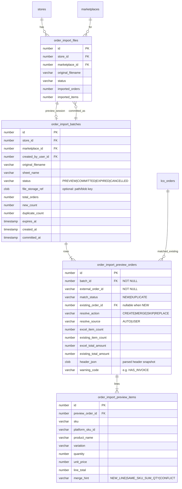
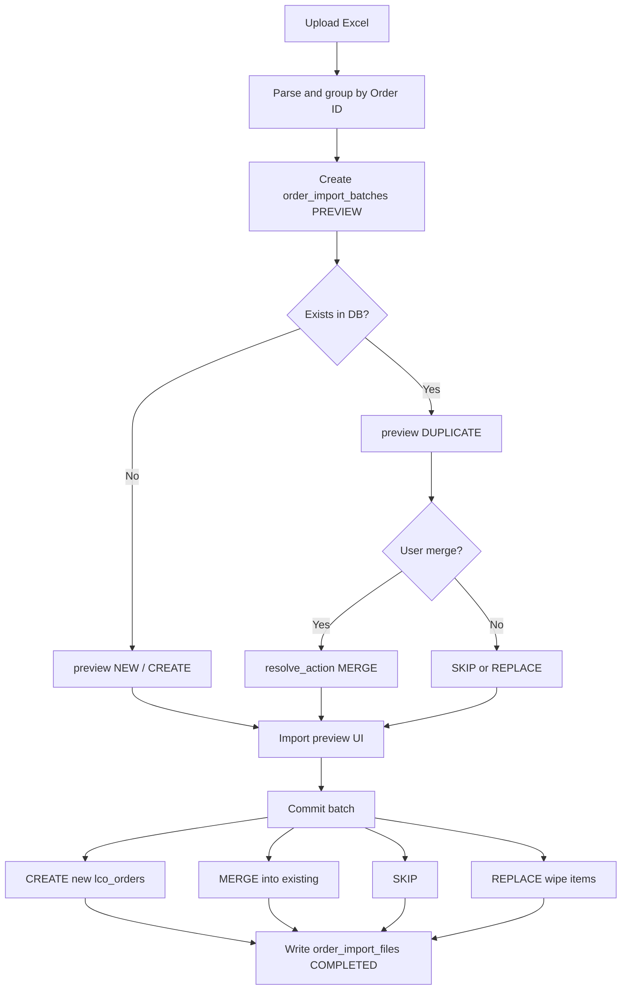

# Order Excel Import Preview + Merge — ERD & Data Model

> **Status:** Implemented (preview → decide → commit)  
> **Goal:** Before applying an Excel import, show an **import preview** (like export preview). Auto-detect when an Excel `Order ID` already exists in DB for the same store + marketplace. Ask the user whether to **merge**; if yes, merge into the existing order.

---

## 1. Problem today

| Behavior | Current |
|----------|---------|
| UI | Upload → import immediately → result counts |
| Same `Order ID` in file | Rows merged in parser (line items appended) |
| Same `Order ID` already in DB | **Silent upsert** by `(store_id, marketplace_id, external_order_id)` then **delete-all + recreate** line items |
| User consent | None |
| DB uniqueness | **No** unique index on that natural key (app lookup only) |

We need a **preview → decide → commit** flow, and an explicit **merge** path when a duplicate exists.

---

## 2. Natural key (business identity)

An imported “order” is identified by:

```text
(store_id, marketplace_id, external_order_id)
```

`external_order_id` = Excel **Order ID** (e.g. TikTok order id).

---

## 3. Current domain ERD (as-is, import-relevant)

```mermaid
erDiagram
    stores ||--o{ lco_orders : "owns"
    marketplaces ||--o{ lco_orders : "sourced_from"
    customers_info ||--o{ lco_orders : "buyer"
    stores ||--o{ customers_info : "scoped"
    lco_orders ||--|{ order_items : "contains"
    products ||--o{ order_items : "sku_ref"
    stores ||--o{ products : "catalog"
    lco_orders ||--o| invoices : "optional 1:1"
    lco_orders ||--o| order_tax_invoices : "optional 1:1"
    stores ||--o{ order_import_files : "import_runs"
    marketplaces ||--o{ order_import_files : "marketplace"

    stores {
        number id PK
        number owner_id FK
        varchar name
        boolean active
    }

    marketplaces {
        number id PK
        varchar code UK "TIKTOK|SHOPEE|LAZADA"
        varchar name
    }

    customers_info {
        number id PK
        number store_id FK
        number marketplace_id FK
        varchar external_customer_id
        varchar name
        varchar phone
        varchar email
        clob address
    }

    lco_orders {
        number id PK
        number store_id FK "NOT NULL"
        number marketplace_id FK "NOT NULL"
        number customer_id FK "NOT NULL"
        varchar external_order_id "logical key part"
        varchar order_status
        number total_amount
        number subtotal
        number shipping_fee
        number amount_ex_vat
        number vat_amount
        varchar source_type "API|IMPORT"
        number source_id "→ order_import_files.id when IMPORT"
        timestamp order_date
        boolean is_enable "soft delete"
    }

    order_items {
        number id PK
        number order_id FK "NOT NULL"
        number product_id FK "NOT NULL"
        varchar platform_sku_id
        varchar sku
        varchar product_name
        varchar variation
        number quantity
        number price
        number line_total
        varchar source_type
        number source_id
        boolean is_enable
    }

    products {
        number id PK
        number store_id FK
        varchar sku
        varchar name
        number price
    }

    invoices {
        number id PK
        number order_id FK UK "1:1"
        varchar invoice_no UK
        varchar status "ISSUED|VOID"
        number grand_total
    }

    order_tax_invoices {
        number id PK
        number order_id FK UK "1:1"
        varchar tax_request_id
    }

    order_import_files {
        number id PK
        number store_id FK
        number marketplace_id FK
        varchar original_filename
        varchar sheet_name
        number row_count
        number imported_orders
        number imported_items
        varchar status "COMPLETED|PARTIAL|FAILED"
    }
```

### Current relations (summary)

| From | To | Cardinality | Notes |
|------|----|-------------|--------|
| `stores` | `lco_orders` | 1:N | Store-scoped |
| `marketplaces` | `lco_orders` | 1:N | Required |
| `customers_info` | `lco_orders` | 1:N | Required buyer |
| `lco_orders` | `order_items` | 1:N | Lines; import currently wipe+recreate |
| `products` | `order_items` | 1:N | Placeholder product by seller SKU if missing |
| `lco_orders` | `invoices` | 1:0..1 | **Not** created by import |
| `order_import_files` | `lco_orders` | logical via `source_id` | No FK today |

---

## 4. Proposed schema changes for preview + merge

### 4.1 Harden natural key (required)

Add a **unique constraint** so duplicates cannot race:

```sql
-- Oracle-style (conceptual)
ALTER TABLE lco_orders
  ADD CONSTRAINT uk_lco_orders_store_mp_ext
  UNIQUE (store_id, marketplace_id, external_order_id);
```

> Soft-delete (`is_enable`) note: if soft-deleted rows can share the same external id, use a **unique function-based / filtered** approach, or hard-block re-import until re-enabled. Recommend: unique among active rows only, or always reuse the soft-deleted row on merge/upsert.

### 4.2 Import batch + preview decisions (new tables)

Preview should feel like **export preview**: parse once, show rows, user confirms, then commit.  
Persist a short-lived **import batch** so commit does not re-upload the file (and merge choices survive refresh).



### 4.3 Why these tables?

| Table | Role |
|-------|------|
| `order_import_batches` | One preview session after upload/parse |
| `order_import_preview_orders` | One Excel order + auto match + user action |
| `order_import_preview_items` | Lines shown in preview / used on commit merge |
| `order_import_files` | Keep as **committed run audit** (when user confirms) |

**Alternative (lighter):** no staging tables — preview is a sync API that returns JSON, and commit re-sends file + decision map. Faster to ship, worse UX on large files / refresh. **Recommend staging tables** for parity with careful export preview UX.

---

## 5. Match + action rules (auto-check)

### 5.1 Auto classification

For each Excel order after parse/group-by Order ID:

```text
IF EXISTS lco_orders WHERE store_id = ? AND marketplace_id = ? AND external_order_id = ?
  THEN match_status = DUPLICATE, existing_order_id = <id>
ELSE
  match_status = NEW
```

### 5.2 Default `resolve_action` (auto)

| `match_status` | Default action | UI |
|----------------|----------------|----|
| `NEW` | `CREATE` | Pre-checked create |
| `DUPLICATE` | *(none — must ask)* | Prompt: **Merge?** Yes → `MERGE`, No → user picks `SKIP` or `REPLACE` |

Recommended UX for duplicate:

1. Dialog / row action: **“Order ID already exists. Merge these two orders?”**
2. **Yes** → `MERGE`
3. **No** → secondary choice: **Skip** (leave DB as-is) or **Replace** (current wipe+recreate behavior)

Bulk: “Merge all duplicates” / “Skip all duplicates”.

### 5.3 Merge semantics (proposed)

When `resolve_action = MERGE` on existing order `E` + Excel order `X`:

| Concern | Rule |
|---------|------|
| Order header | Keep `E.id`. Prefer newer non-null header fields from `X` (status, dates, shipping, buyer if richer). Do **not** change `external_order_id`. |
| Customer | Keep `E.customer` unless Excel has better phone/name; optionally update `customers_info` in place |
| Line items | **Union by line key** `(platform_sku_id \|\| sku, variation)`: if same key exists, **sum quantities** and recompute `line_total`; else **append** new `order_items` |
| Totals | Recalculate `subtotal` / VAT / `total_amount` from resulting items + shipping (document exact formula to match TikTok sheet) |
| Invoice | If `invoices` exists for `E`: **block REPLACE**; for MERGE allow only if totals unchanged **or** set `warning_code=HAS_INVOICE` and require extra confirm |
| Tax invoice | Upsert `order_tax_invoices` if Excel has tax columns |
| Source | Set `source_type=IMPORT`, `source_id=committed import_file_id` |



### 5.4 REPLACE vs MERGE (contrast)

| | MERGE | REPLACE (today’s upsert) |
|--|-------|---------------------------|
| Existing items | Keep + add/sum | Delete all, recreate from Excel |
| Missing from Excel | Stay on order | Removed |
| Risk if invoice exists | Lower if additive | High (totals may diverge from issued invoice) |

---

## 6. API shape (logical, for later implementation)

| Step | Method | Purpose |
|------|--------|---------|
| 1. Preview | `POST /v1/orders/import/preview` | Multipart file + `storeId` + `marketplaceCode` → create batch + return preview rows |
| 2. Decide | `PATCH /v1/orders/import/preview/{batchId}/orders` | Set `resolve_action` per duplicate (or bulk) |
| 3. Commit | `POST /v1/orders/import/preview/{batchId}/commit` | Apply actions; write `order_import_files`; mark batch `COMMITTED` |

Preview response row (conceptual):

```json
{
  "externalOrderId": "5839…",
  "matchStatus": "DUPLICATE",
  "existingOrderId": 42,
  "excelItemCount": 3,
  "existingItemCount": 2,
  "resolveAction": null,
  "warningCode": null
}
```

---

## 7. Indexes / constraints checklist

| Object | Change |
|--------|--------|
| `lco_orders` | **Add** `UNIQUE (store_id, marketplace_id, external_order_id)` |
| `order_import_batches` | Index `(store_id, status, expires_at)` |
| `order_import_preview_orders` | Unique `(batch_id, external_order_id)` |
| `order_import_preview_items` | Index `(preview_order_id)` |
| `order_items` | Optional unique `(order_id, platform_sku_id, variation)` later to make merge idempotent — **not required for v1** if merge is app-logic |

---

## 8. Out of scope (v1)

- Merging across different stores/marketplaces
- Auto-void / regenerate invoices on merge
- Cross-file multi-batch merge
- Changing marketplace API sync upsert (can adopt same MERGE later)

---

## 9. Implementation order (after you approve this ERD)

1. DB: unique constraint on natural key  
2. Tables: `order_import_batches`, `order_import_preview_orders`, `order_import_preview_items`  
3. Backend: preview + decide + commit services (reuse `OrderSkuListExcelParser`)  
4. Frontend: Import preview dialog (mirror export preview) + merge confirm for duplicates  
5. Keep existing direct `POST /import` deprecated or wired as “commit with defaults” for API clients  

---

## 10. Locked decisions

1. **On “No” to merge:** default **Skip**; **Replace** available as an explicit row/bulk action.
2. **Merge line key:** `(platformSkuId or sku) + variation` (empty-safe).
3. **If order already has an invoice:** **MERGE allowed** with `HAS_INVOICE` warning; **REPLACE blocked**.
4. **Persist preview batches** in staging tables (`order_import_batches` + preview orders/items).
