# Laco Invoice — User Journey v5

> Only **Print** and **Reprint** connect to Download type.
> Debit memo, ERP voucher, Add/edit items, and Manage PO are terminal nodes.

```mermaid
flowchart TD

    %% ── AUTH ──
    START([Visit Laco Invoice])
    START --> HAS_ACCOUNT{Has an account?}
    HAS_ACCOUNT -- No --> REGISTER[Register\nemail + PW]
    REGISTER --> LOGIN
    HAS_ACCOUNT -- Yes --> LOGIN[Login\nemail + PW → JWT issued]

    %% ── SETUP ──
    LOGIN --> STORE_CONNECTED{Store connected?\nany marketplace account linked}
    STORE_CONNECTED -- No --> ADD_STORE[Add store\nname + logo]
    ADD_STORE --> CONNECT_MKT[Connect marketplace\nTikTok · Shopee · Lazada…]
    CONNECT_MKT --> STORE_CONNECTED
    STORE_CONNECTED -- Yes --> DASHBOARD[Dashboard\nrevenue · orders · invoices summary]

    %% ── SYNC ──
    DASHBOARD --> TRIGGER_SYNC[Trigger order sync\nmanual or auto every 10 min]
    TRIGGER_SYNC --> RESOLVE_ADAPTER[Resolve marketplace adapter\nTikTok · Shopee · Lazada · Amazon…]
    RESOLVE_ADAPTER --> SYNC_OK{Sync successful?\nAPI call + normalize response}
    SYNC_OK -- Fail --> LOG_ERROR[Log error\nretry in 30 min]
    LOG_ERROR --> TRIGGER_SYNC

    %% ── ORDERS ──
    SYNC_OK -- OK --> ORDERS_LIST[Orders list\nsearch · filter by status / date / marketplace]
    ORDERS_LIST --> ORDER_DETAIL[Order detail\nitems · amounts · buyer info]
    ORDER_DETAIL --> INV_EXISTS{Invoice already exists?}
    INV_EXISTS -- Yes --> VIEW_INV[View invoice]
    VIEW_INV --> APPLY_VAT

    %% ── INVOICE GENERATION ──
    INV_EXISTS -- No --> GEN_INV[Generate invoice\nassign INV-YYYYMM-000001]
    GEN_INV --> APPLY_VAT[Apply 7% VAT\nevery invoice = Tax Invoice / Receipt]
    APPLY_VAT --> RENDER_PDF[Render PDF\nHTML template → ChromeDP → PDF]
    RENDER_PDF --> INV_REGISTERED[Invoice registered]

    %% ── WHAT NEXT? — 5 BRANCHES ──
    INV_REGISTERED --> WHAT_NEXT{What next?}

    %% Branch 1: Print → Download type
    WHAT_NEXT -- Print --> PRINT[Print / download\nPDF or bulk ZIP]
    PRINT --> DL_TYPE

    %% Branch 2: Refund → Credit memo → Debit memo (terminal)
    WHAT_NEXT -- Refund/Return --> REFUND[Refund / Return\norder partially or fully]
    REFUND --> CREDIT_MEMO[Credit memo\nCM-YYYYMM-000001]
    CREDIT_MEMO --> DEBIT_MEMO[Debit memo\nDM-YYYYMM-000001]

    %% Branch 3: ERP voucher (terminal)
    WHAT_NEXT -- ERP --> ERP_VOUCHER[ERP voucher\ninvoice → ERP input]

    %% Branch 4: Cancel / Void → Voided → Reprint → Download type
    WHAT_NEXT -- Cancel/Void --> CANCEL[Cancel / Void order]
    CANCEL --> INV_VOIDED[Invoice voided\nstatus: Cancelled]
    INV_VOIDED --> REPRINT[Reprint\nmanager role only 🔒]
    REPRINT --> DL_TYPE

    %% Branch 5a: Manage store products → Add/edit items (terminal)
    WHAT_NEXT -- Store products --> STORE_PRODUCTS[Manage store products\nproduct catalogue]
    STORE_PRODUCTS --> EDIT_ITEMS[Add / edit items\nname, SKU, price]

    %% Branch 5b: Manage ERP items → Manage PO (terminal)
    WHAT_NEXT -- ERP items --> ERP_ITEMS[Manage ERP items\nERP item master]
    ERP_ITEMS --> MANAGE_PO[Manage PO\npurchase orders]

    %% ── EXPORT ──
    DL_TYPE{Download type?}
    DL_TYPE -- Single --> SINGLE_PDF[Single PDF download]
    DL_TYPE -- Bulk --> BULK_ZIP[ZIP archive\nmultiple PDFs]
    SINGLE_PDF --> DONE[File downloaded\n↻ back to dashboard]
    BULK_ZIP --> DONE
    DONE --> DASHBOARD

    %% ── STYLES ──
    classDef auth     fill:#534AB7,stroke:#3C3489,color:#EEEDFE
    classDef setup    fill:#0F6E56,stroke:#085041,color:#E1F5EE
    classDef sync     fill:#185FA5,stroke:#0C447C,color:#E6F1FB
    classDef orders   fill:#185FA5,stroke:#0C447C,color:#E6F1FB
    classDef invoice  fill:#993C1D,stroke:#712B13,color:#FAECE7
    classDef memo     fill:#854F0B,stroke:#633806,color:#FAEEDA
    classDef erp      fill:#534AB7,stroke:#3C3489,color:#EEEDFE
    classDef void     fill:#5F5E5A,stroke:#444441,color:#F1EFE8
    classDef products fill:#0F6E56,stroke:#085041,color:#E1F5EE
    classDef export   fill:#5F5E5A,stroke:#444441,color:#F1EFE8
    classDef neutral  fill:#444441,stroke:#2C2C2A,color:#F1EFE8
    classDef error    fill:#444441,stroke:#2C2C2A,color:#F1EFE8

    class START neutral
    class HAS_ACCOUNT,REGISTER,LOGIN auth
    class STORE_CONNECTED,ADD_STORE,CONNECT_MKT,DASHBOARD setup
    class TRIGGER_SYNC,RESOLVE_ADAPTER,SYNC_OK sync
    class LOG_ERROR error
    class ORDERS_LIST,ORDER_DETAIL,INV_EXISTS orders
    class GEN_INV,APPLY_VAT,RENDER_PDF,INV_REGISTERED,VIEW_INV,WHAT_NEXT,PRINT invoice
    class REFUND,CREDIT_MEMO,DEBIT_MEMO memo
    class ERP_VOUCHER erp
    class CANCEL,INV_VOIDED,REPRINT void
    class STORE_PRODUCTS,EDIT_ITEMS,ERP_ITEMS,MANAGE_PO products
    class DL_TYPE,SINGLE_PDF,BULK_ZIP,DONE export
```

---

## Terminal vs. download-connected branches

| Branch | Connects to download? |
|---|---|
| Print / download | Yes → Download type |
| Reprint (after void) | Yes → Download type |
| Debit memo | No — terminal |
| ERP voucher | No — terminal |
| Add / edit items | No — terminal |
| Manage PO | No — terminal |